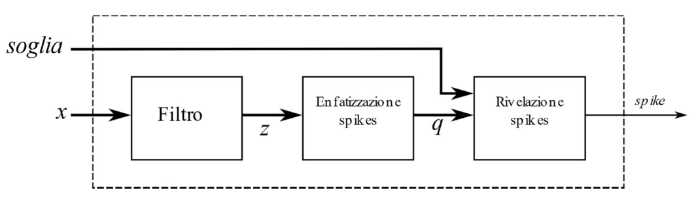
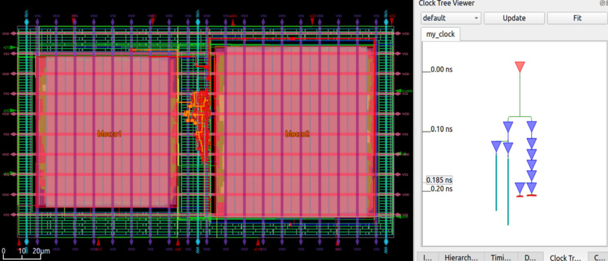

# Spike-detector ASIC — RTL to GDS in 45 nm

Project for **Architettura dei Sistemi Integrati** (Integrated Systems Architecture), M.Sc. Electronic Engineering, University of Naples Federico II, a.y. 2024/2025.

A digital integrated circuit that detects **spikes** in a sampled sensor signal. The chain was designed in SystemVerilog, verified with self-checking testbenches and taken through the full **RTL-to-layout** flow (synthesis, floorplan, placement, clock-tree synthesis, routing, sign-off) on the open-source **Nangate 45 nm** standard-cell library.

## Architecture

| Block | Folder | Description |
| --- | --- | --- |
| **IIR filter** | `1-iir/` | 4th-order IIR filter built as two cascaded biquad sections (`iir_section1/2`), fixed point Q1.10 in / Q3.20 internal with rounding |
| **Spike emphasis** | `2-enfasi/` | `aso` (amplitude-slope operator) followed by an 8-tap symmetric FIR (`fir`), wrapped in `enfasi` |
| **Detector** | `3-detector/` | `ser_par` loads the 12-bit threshold serially (MSB first); `fsm` is a 7-state machine that asserts `spike` only after consecutive samples above threshold (glitch rejection) |
| **Top** | `3-detector/backend/src/top.sv` | `iir → enfasi → detector`; the IIR and emphasis blocks are placed as hard macros |

Each block has a `frontend/` (RTL + testbenches + stimulus/golden vectors) and a `backend/` (`sintesi.tcl`, `floorplan.tcl`, `placement.tcl`, `cts.tcl`, `route.tcl`, `final.tcl`, `constraints.sdc` — 100 MHz clock, 100 ps jitter).

## Results (post-route)

| Block | Area | Setup slack | Hold slack | Power |
| --- | --- | --- | --- | --- |
| IIR | 3 839 µm² (3 015 cells) | 6.42 ns | 0.105 ns | — |
| Emphasis (ASO + FIR) | 5 827 µm² (3 802 cells) | 5.79 ns | 0.106 ns | 3.94 mW |
| **Full chip** | **12 139 µm²** | **4.59 ns** | **0.104 ns** | **94.4 µW** |

Hold violations found after placement and CTS were fixed by buffer insertion (e.g. 27 buffers after CTS, hold slack 1 ps → 102 ps). Clock tree: H-tree.

Full write-up (Italian): [`docs/report.pdf`](docs/report.pdf).

## Skills

SystemVerilog · fixed-point DSP (IIR/FIR) · FSM design · testbenches · logic synthesis · floorplanning · placement · CTS · routing · static timing analysis · power analysis
